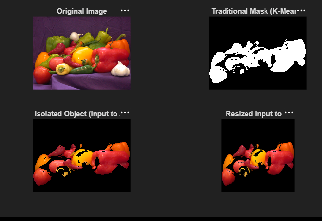
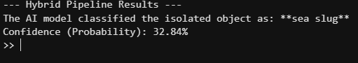

# Hybrid Computer Vision Pipeline: K-Means + SqueezeNet

This project combines traditional color segmentation (K-Means) with a pre-trained AI model (SqueezeNet) in MATLAB to isolate and classify an object.

## Sections

### 1. Load Image and AI Network
Loaded `peppers.png` and MATLAB's pre-trained `SqueezeNet` image classification network.

### 2. Traditional Segmentation (K-Means)
Converted the image to Lab color space and used `imsegkmeans` to group pixels into 2 color clusters. Created a binary mask to separate the main object and turn the background black.

### 3. AI Classification (SqueezeNet)
Resized the isolated object to `227x227` pixels (the input size required by SqueezeNet) and used `classify` to predict what the object is.

### 4. Results Analysis

* **Predicted Class:** *Sea Slug*
* **Confidence:** *32.84%*

**Why combine both methods?** Removing the messy background first with K-Means helps the AI focus only on the target object, leading to cleaner and more reliable classification results, however this does not guarantee perfection.

## AI Usage

* **Tool used: Claude (Anthropic)**
* **How I used it: I used it to explain squeezenet**