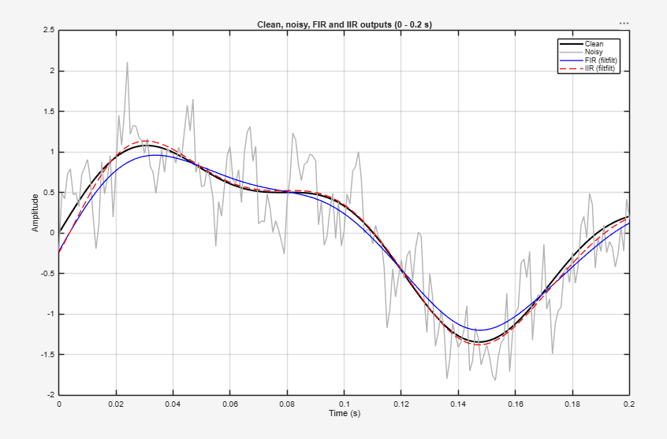
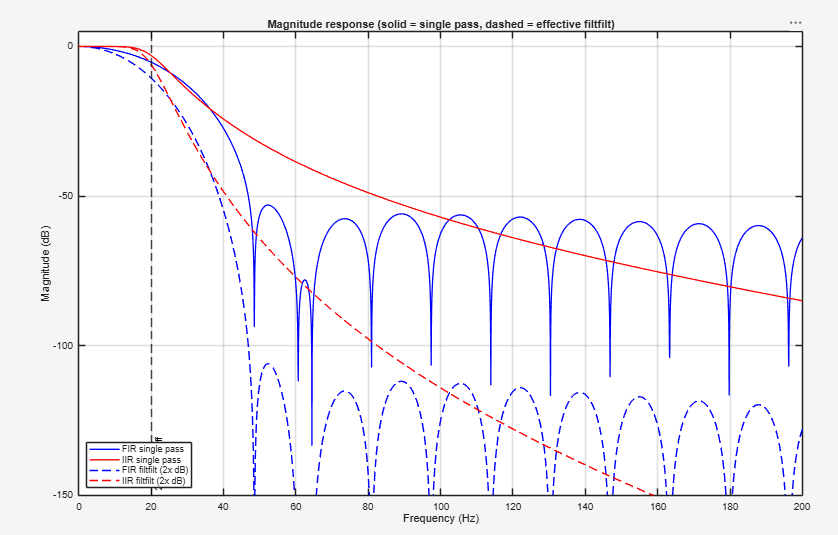
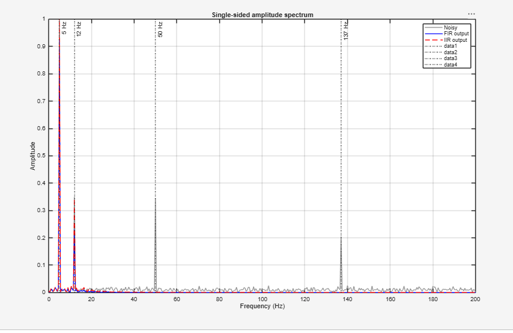
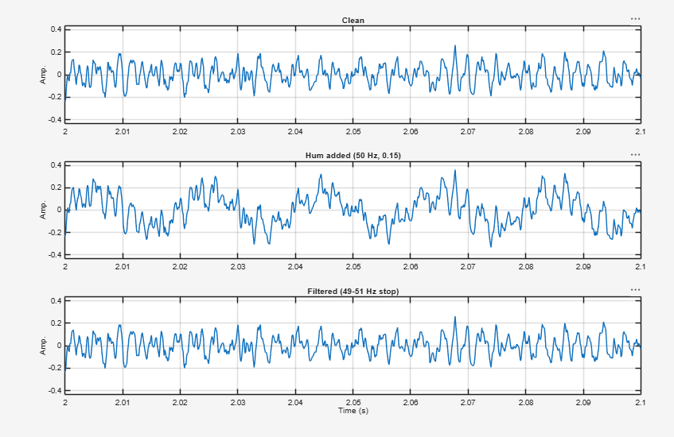
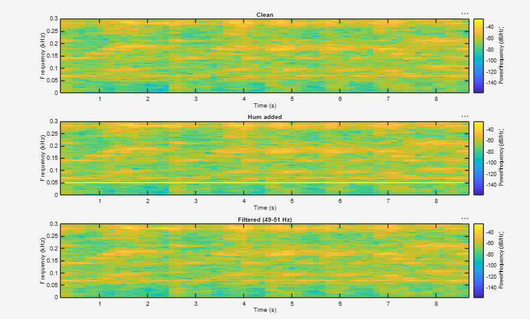

# Digital Filters Assignment Report

## Part A: Filter a Sensor Signal

### 1\. Time-Domain Comparison

**

### 2\. Frequency Responses

**

### 3\. Amplitude Spectra

**

Both filters allow 5Hz signal near perfectly, the FIR only allows about 60% amplitude at 12Hz while the IIR allows almost full amplitude at 12Hz, noisy spikes at 50 and 137 are attenuated 

4\. RMSE Calculation

|Signal|RMSE against Clean Signal|
|-|-|
|Noisy Input|0.3801|
|FIR Output|0.1056|
|IIR Output|0.0548|

* **What RMSE tells us:** The amount of error between each signal and the filter or noise
* **What RMSE cannot tell us:** Source of error and direction of error (over/undershooting)

### 5\. Filter Design Comparison

* **Coefficient/Order count:** FIR uses 61 coefficients making it more computationally demanding, while the IIR only uses 10. This means the FIR does around 6 times more multiplication and addition operations. 
* **Transition behavior:** FIR cuts off much sharper than the IIR after 20 Hz
* **Edge effects:** The FIR has a strange bouncing effect starting at 50 Hz.
* **When to prefer FIR:** When absolute linear phase is critical like in ECG/EEG machines.
* **When to prefer IIR:** IIR is useful for real-time processing on embedded systems, microcontrollers, or low-power DSP chips where computational resources and memory are strictly limited.

\---

## Part B: Reduce a 50 Hz Hum in Audio

### 1\. Waveform Comparison

**

### 2\. Audio Spectrum / Spectrogram

**

* **Artificially added noise is the yellow line at 50Hz.**

### 3\. Listening Test

* **Observation:** It is quite hard to hear if there is distortion or not although with the wider band of filter some of the original handel signal was removed. 

### 4\. 50 Hz Amplitude Measurement

* **Measurement Method:** I evaluated freqz at 50 Hz and doubled the dB value to get the effective filtfilt response.
* **Amplitude Before Filtering:** 0.106065
* **Amplitude After Filtering:** 0.005262

### 5\. Stop-Band Width Trade-off

* **Observation with 45–55 Hz band:** Amplitude is 0.003319 
* **Explanation:** A band-stop filter attenuates everything inside its stop band, not just the hum. A wider band keeps removing the hum if it moves off 50.00 Hz. The same widening also removes real audio between roughly 44 and 56 Hz, such as bass notes and low rumble.

\---

## Report Questions

**1. Why is a 20 Hz low-pass reasonable for Part A, and what assumption does it make about the wanted sensor signal?**

* The wanted components are at 5 Hz and 12 Hz, so 20 Hz sits above both. The filter assumes that all useful information is slowly varying and that everything above is noise.

**2. Which filter gives the better result for the requirements you chose? Support the answer with at least two kinds of evidence.**

* For the requirements of recovering 5 and 12 Hz components offline, the IIR is better because of smaller RMSE against the clean signal and the gain at 12 Hz is around -0.07dB vs -1.8dB of the FIR

**3. How would your implementation change if the sensor had to be filtered live with low latency?**

* The function filtfilt could not be used, because it needs the whole recording and is non-causal

**4. Why is a narrow band-stop appropriate for a steady 50 Hz hum? What would you do if the interference frequency drifted?**

* A steady hum occupies a single frequency, so a narrow notch removes it while leaving neighboring frequencies, including the wanted audio, almost untouched.

**5. Describe one limitation of your experiments and one improvement you would make in a real measurement system.**

* The experiments use synthetic signals. The sensor noise is stationary from a single seed, and the hum is exactly 50.000 Hz at constant amplitude. Real interference drifts and varies, so my results may overstate how well a narrow notch works.
* In a real measurement system I would reduce the interference at the source, with shielding, grounding, and differential inputs, and add an analog anti-aliasing filter before the ADC. I would also repeat the test over many noise realizations and on real recordings.

\---

## AI Usage

* **Tool used: Claude (Anthropic)**
* **How I used it: I used it to draft the MATLAB script for Parts A and B as well as a formatted README template.**
* **What I verified or changed: I verified the filtering coefficient logic using notes from class**

