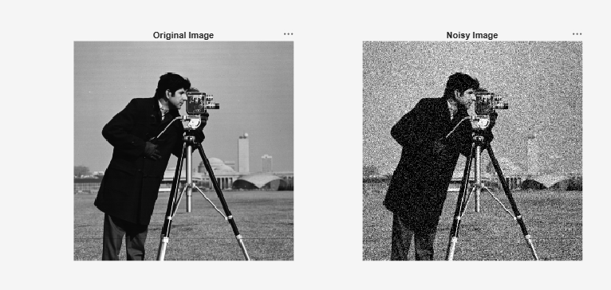
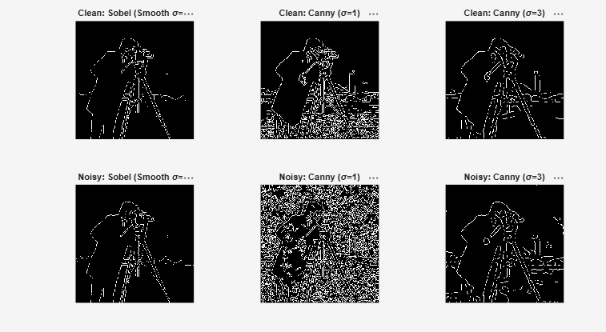

# DSP Image Processing Assignment: Comparing Edge Detectors

## Selected Option
**Option C:** Compare edge detectors.

## Supplied Images
* `cameraman.tif`

## Settings Used
* **Noise Generation:** Gaussian noise with mean `0` and variance `0.01` (Random seed `rng(42)`).
* **Detector 1 (Sobel):** Applied to the image smoothed with a Gaussian filter (`imgaussfilt` with $\sigma = 1$).
* **Detector 2 (Canny):** Default thresholds, Gaussian smoothing $\sigma = 1$.
* **Detector 3 (Canny):** Default thresholds, Gaussian smoothing $\sigma = 3$.

## Instructions for Running the Live Script
1. Clone or download this repository to your local machine.
2. Open MATLAB and navigate to the repository folder.
3. Open the `analysis.mlx` file.
4. Click the **"Run"** button in the Live Editor tab (or press `F5`) to execute the entire script.
5. The edge maps, side-by-side comparisons, and calculated `nnz` (number of non-zero edge pixels) values will display directly within the Live Script.
6. The script will automatically generate and save the output figures to the `results/` directory. If you do not have MATLAB installed, you can view the static output in the provided `analysis.pdf` file.

## Figures

**

**

## Main Conclusion
Increasing the standard deviation ($\sigma$) of the Gaussian smoothing is highly effective at suppressing false edges caused by speckle noise (as seen when increasing Canny's $\sigma$ from 1 to 3 in the noisy image). However, there is a distinct trade-off: aggressive smoothing blurs the real structural boundaries, causing fine details like background buildings or thin objects to be completely lost in the final edge map. 

## Limitation of the Analysis
The edge-pixel count (`nnz`) is used to quantify the results, but it does not measure correctness. It simply counts how many pixels were flagged as edges. A high `nnz` value in the noisy image reflects a massive amount of false noise edges being detected, not a highly accurate map. Without a ground-truth map to compare against, `nnz` measures pixel density rather than edge accuracy.

## AI Usage

* **Tool used: Google Gemini**
* **How I used it: I used it to draft the Matlab script, as well as format and provide a readme template.**
* **What I verified or changed: I verified the figures and logic matched similar results in the class example**