# Lab 6: Bird Detection & Outline Extraction Pipeline

## 1. Problem & Goal
I took the source photo through binoculars, creating a black circular area around the image that skews the histogram, alongside blurry pine needles obscuring the bird. The goal is to isolate the bird and extract its outline using spatial and frequency-domain DSP techniques.

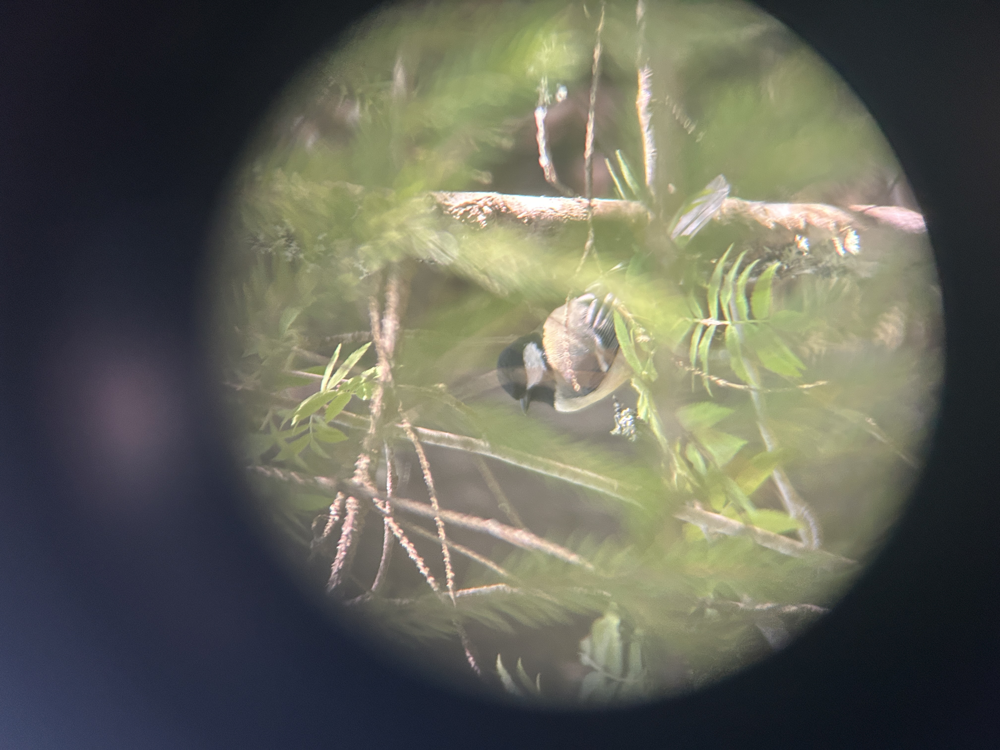

## 2. Processing Pipeline
At first I started with just simple gray scale canny edge detection, this did not work very well so I decided to evaluate the R G and B components separately and found that they can extract different components of the bird. This lead me to experiment with combining the RGB edge componenets which turned out to work nicely. I wanted to take this a step further and apply morphological closing to each component and then combine them but I found that closing works better after combining each of the RGB edges allowing the R G and B components to build off each other. See section 3 Method Comparisons.

| Stage | MATLAB Operations | Purpose & DSP Role | Screenshot |
| :--- | :--- | :--- | :---: |
| **1. Crop & RGB Split** | `rot90`, `imcrop`, `I(:,:,c)` | Spatial windowing (`[2200×1700]` ROI) removes the black binocular border to prevent histogram skew. Splits R, G, and B bands (`R`/`G` highlight the dark head; `B` highlights the back and chest). | 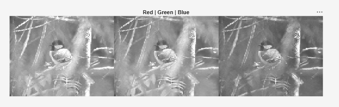 |
| **2. Denoising** | `medfilt2(..., [3 3])` | simple 2d 3x3 median filter removes sensor/JPEG grain while preserving sharp step edges. | 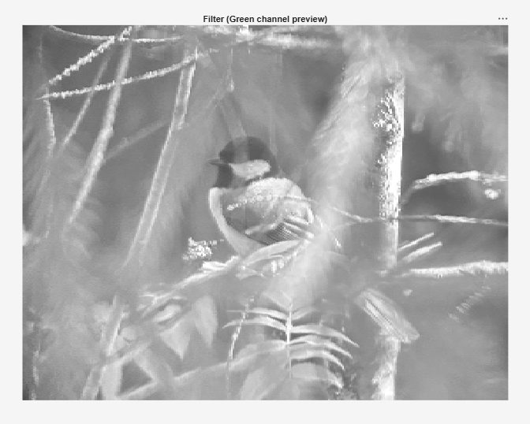 |
| **3. Contrast & Gamma** | `imadjust(..., [0.2 0.8], [0 1], 1.4)` | Power-law amplitude mapping ($\gamma = 1.4$) darkens grey midtone branch haze while keeping bright plumage prominent. | 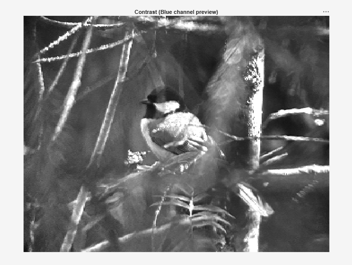 |
| **4. Hybrid Feature Extraction** | `edge('Canny')`, `imclose`, `bwareaopen`, `multithresh` | Merges Canny edges ($\sigma = 2.5$) across R, G, and B before morphological closing (`disk`, `r=5`) and area opening (`950 px`), then combines (`\|`) with Otsu bright regions (`B_enh > thresh(2)`) to reconstruct the bird's body. | 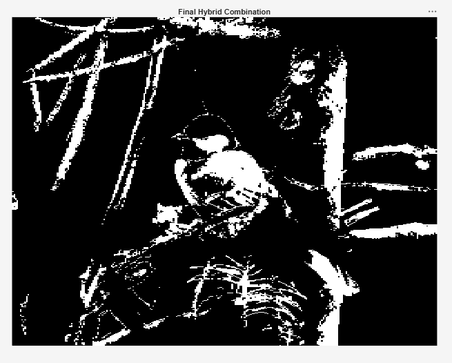 |
| **5. Frequency Low-Pass** | `fft2`, `fftshift`, `ifft2` | Multiplies the 2D spectrum by an ideal circular low-pass mask ($D_0 = 60$) to isolate low-frequency bulk structure from high-frequency needle/feather texture. | 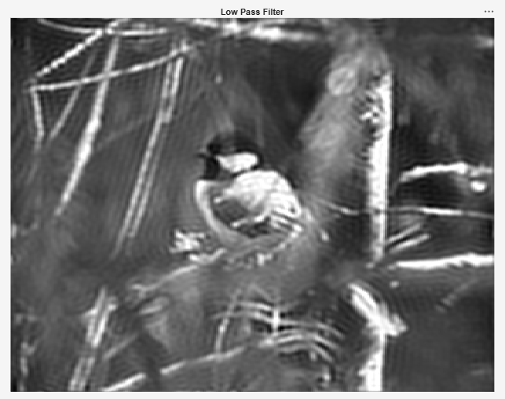 |

### Full Pipeline Summary
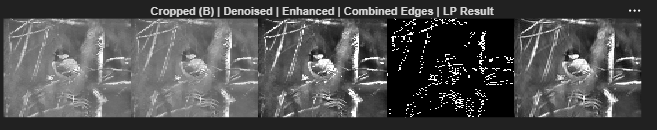

## 3. Method Comparisons

| Comparison | Approaches Tested | Observations & Takeaway | Visual |
| :--- | :--- | :--- | :---: |
| **RGB Separate Morphology vs. Combined Then Morphology** | Clean each channel separately vs. merge `edges_R \| edges_G \| edges_B` *before* morphology | Cleaning each channel individually deleted valid partial bird contours before they could connect. Merging raw RGB edges *first* allowed `imclose` to bridge gaps across color bands and `bwareaopen` to retain the full bird. | 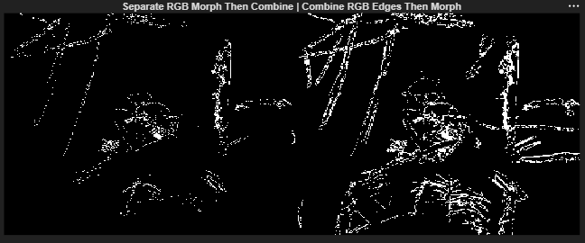 |
| **Otsu vs. Canny** | Canny edges alone vs. Multi-Level Otsu (`multithresh`) vs. Hybrid (`edges_clean \| bright_parts`) | Canny traced sharp boundaries well but left the body hollow; Otsu `bright_parts` captured the solid yellow chest/white cheek, while `dark_parts` (`R_enh < thresh(1)`) captured the black head alongside dark corner shadows. Merging Canny + Otsu bright gave the cleanest body reconstruction. | 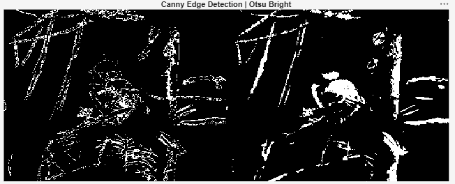 |

## 4. Evaluation & Improvements
- **Strengths:** Fusing R, G, and B edges *before* morphological cleanup preserved partial contours broken in single channels, while combining Canny edges with Otsu bright thresholding filled in the bird's body cleanly.
- **Limitations:** Bright highlights on foreground pine needles still pass intensity thresholds, and the ideal circular FFT filter introduces mild Gibbs ringing. Also, with proper tuning, handling each R, G, and B channels' feature extracting could yield better results, but it was out of scope for this project.

## Enhancing original image

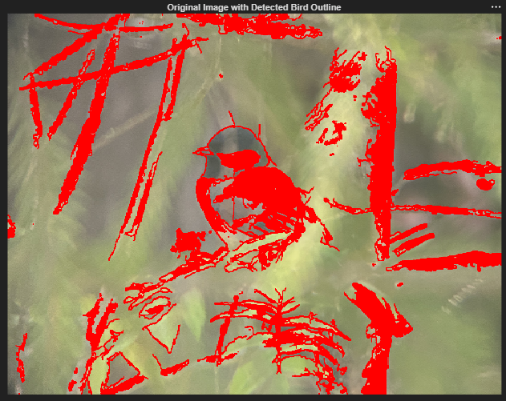

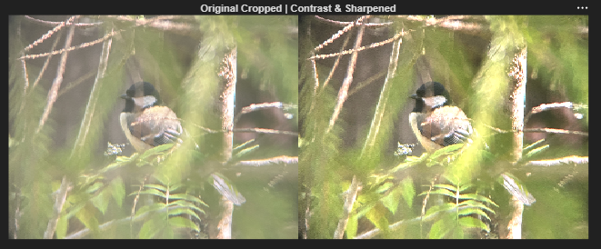

## AI Usage

* **Tool used: Google Gemini**
* **How I used it: Used for explaining different matlab tools available, refining the script, and drafting a readme template**
* **What I verified or changed: I designed the pipeline and tuned the parameters**
